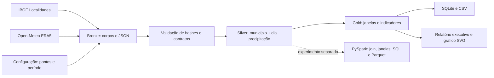

# Arquitetura e processamento

## Decisões técnicas

O pipeline principal utiliza Python e SQLite por permitir execução local sem serviços pagos ou instalação de pacotes. O recorte possui 3.288 linhas e não justifica infraestrutura distribuída permanente. O padrão Medallion organiza responsabilidades independentemente do tamanho da base. Não há implantação em nuvem ou alegação de processamento distribuído no pipeline principal.

Os dados brutos ficam em `data/bronze/<execucao>`; Silver, Gold e os produtos analíticos ficam em `output/<execucao>`. O manifesto conecta as camadas ao mesmo snapshot. Identificadores com horário UTC e sufixo aleatório evitam sobrescrever resultados. Publicação é feita depois da validação dos dados; falhas de disco durante escrita ainda podem deixar uma pasta de saída parcial, que deve ser desconsiderada se o comando não terminar com sucesso.

## Etapas

1. Validar configuração e intervalo histórico.
2. Adquirir cadastro IBGE e série meteorológica por município, com timeout de 45 segundos e até três tentativas para falhas transitórias.
3. Preservar corpo original, normalizar JSON, calcular hashes e registrar URLs e horários no manifesto.
4. Validar integridade do snapshot, identidade IBGE, timezone, unidade, datas e valores.
5. Enriquecer cada dia com município, UF, região e coordenadas solicitadas/retornadas.
6. Calcular features por município e por dia de calendário, sem preencher nulos com zero.
7. Agregar meses e registrar denominadores, cobertura e estatística descritiva.
8. Exportar CSV, SQLite, relatório e gráfico comparativo.

## Qualidade e rastreabilidade

- Datas devem corresponder exatamente ao intervalo esperado, em ordem e sem duplicações. Ano bissexto é tratado pelo calendário do Python.
- Valores negativos, booleanos, textos, NaN e infinitos são rejeitados. Ausências explícitas são preservadas.
- Uma resposta com datas ausentes é rejeitada; um dia existente com valor nulo é preservado e reduz a cobertura.
- Janelas exigem todos os dias e valores; dias de municípios diferentes nunca se misturam.
- A Gold diária e mensal têm índices únicos no SQLite.
- Apenas meses com `full_calendar_month = 1` participam do ranking do relatório. A cobertura é relativa ao recorte solicitado; o indicador adicional exige todos os dias do mês civil, excluindo também os meses parciais nas bordas do recorte.
- `quality.json` registra linhas, chaves únicas, valores ausentes, meses incompletos e janelas de três dias nulas.
- Os arquivos brutos permanecem disponíveis para auditoria e replay; não há fallback para dados simulados.

Para comparação de meses, manter datas de início/fim em limites mensais como na configuração entregue. A execução de referência cobre meses completos.

## Feature Engineering e análise

As janelas de três e sete dias representam acúmulo de chuva; não são medidas de saturação do solo, vazão ou área inundada. O acumulado antecedente exclui o dia corrente e pode auxiliar uma investigação futura de relação entre chuva prévia e ocorrências, quando estas forem integradas. Valores são arredondados a três casas decimais nas somas das janelas para evitar ruído de ponto flutuante.

Os limiares são parâmetros exploratórios e permitem observar sensibilidade; o código não combina esses indicadores em um escore de risco. P95 e intervalos de Wilson acrescentam descrição da distribuição e da frequência, com as hipóteses e limitações registradas no catálogo e relatório. Não há modelo de Machine Learning: falta uma variável-alvo de inundação confirmada para treinamento e avaliação pertinentes.

## Reprodução e operação

Uma execução nova consulta as APIs e pode encontrar revisões dos provedores. Para reprodução exata, usar `--bronze` sobre o snapshot preservado; o manifesto determina parâmetros e fontes. Não é necessário acesso à rede durante o replay. Não há agendamento, monitoramento remoto ou armazenamento em nuvem configurados.

Uma evolução de implantação pode armazenar Bronze/Silver/Gold em armazenamento de objetos e executar o mesmo fluxo com orquestração e logs centralizados. Essa evolução exige dimensionamento, credenciais e avaliação de custo específicos, ainda fora da implementação local.

## Validação

`python -m unittest discover -s tests -v` exercita valores inválidos, nulos, datas ausentes/duplicadas/desordenadas, unidades, timezone, identidade municipal, janelas, fronteiras entre municípios, gzip, percentil, Wilson, integridade do snapshot e reprodução de tabelas. Os testes usam dados sintéticos identificados como tal; as análises entregues usam a coleta real.
