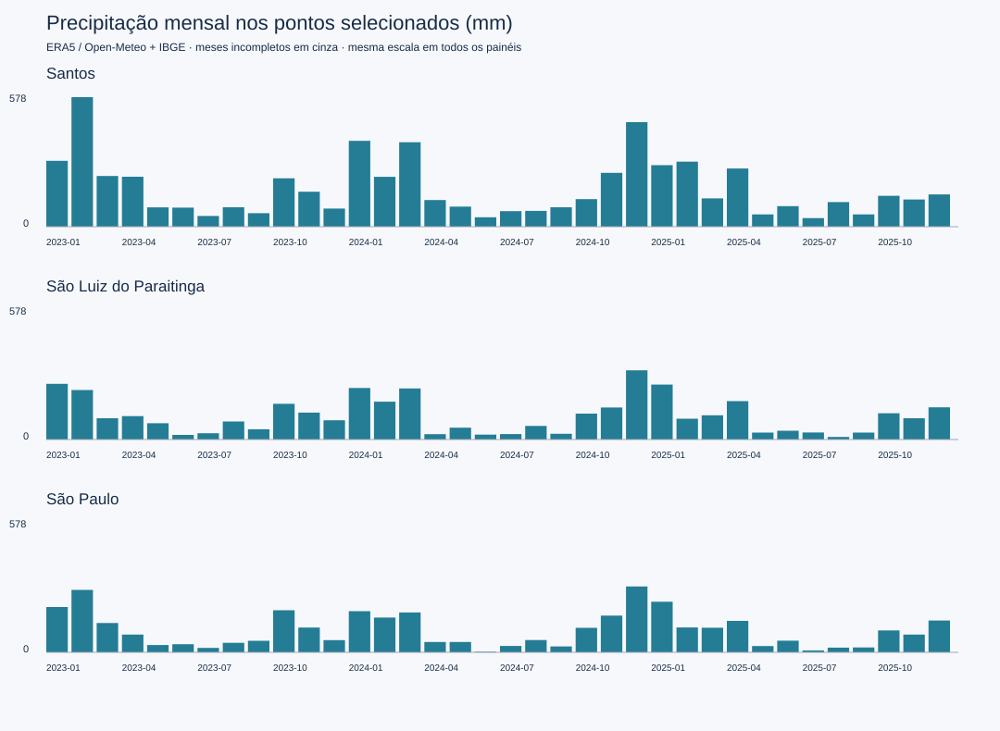

# Relatório executivo: chuvas e preparação para enchentes

**Integrantes:** Kaue Lima — RM 562071; Pedro Gonçalves — RM 561506; Edmario — RM 565486.

Execução: `20261109T125036Z_b1308a4d`. Período: 2023-01-01 a 2025-12-31.

Reanálise ERA5 obtida via Open-Meteo, integrada ao cadastro do IBGE. Cada município é representado por um ponto configurado; os valores não são médias municipais nem medições de pluviômetros.

Limiares exploratórios: chuva diária >= 50 mm; acumulado de 3 dias >= 100 mm. Não são alertas oficiais ou probabilidades de inundação.

| Município | Dias válidos/esperados | Total observado (mm) | Máximo diário (mm) | Dias acima do limiar | P95 dos dias chuvosos (mm) |
|---|---:|---:|---:|---:|---:|
| São Paulo | 1096/1096 | 3553.8 | 58.1 | 1 | 22.9 |
| Santos | 1096/1096 | 6131.6 | 179.7 | 15 | 32.4 |
| São Luiz do Paraitinga | 1096/1096 | 3801.2 | 44.1 | 0 | 25.4 |

## Evidências e decisões

- Santos em 2023-02: 577.8 mm, 2 dias acima do limiar diário e 4 dias acima do acumulado de 3 dias.
- Santos em 2024-12: 466.2 mm, 3 dias acima do limiar diário e 3 dias acima do acumulado de 3 dias.
- Santos em 2024-01: 383.0 mm, 2 dias acima do limiar diário e 2 dias acima do acumulado de 3 dias.
- Santos em 2024-03: 377.0 mm, 2 dias acima do limiar diário e 0 dias acima do acumulado de 3 dias.
- São Luiz do Paraitinga em 2024-12: 308.6 mm, 0 dias acima do limiar diário e 0 dias acima do acumulado de 3 dias.

Os meses acima tiveram os maiores totais entre os meses completos da amostra. Usá-los para selecionar períodos de investigação e planejar inspeções de drenagem. A chuva isolada não demonstra ocorrência ou dano de enchente.

## Análise estatística e interpretação

gold/monthly.csv inclui a frequência de dias acima do limiar e intervalo de Wilson de 95%. O denominador inclui apenas dias com valor válido. O intervalo pressupõe ensaios independentes e serve apenas como referência descritiva: a autocorrelação da chuva limita sua interpretação inferencial. Meses incompletos não entram no ranking acima.

O P95 usa interpolação linear sobre dias com pelo menos 1 mm em todo o período. É uma referência retrospectiva da amostra, sem aplicação preditiva. Três anos não constituem normal climatológica nem permitem atribuir tendências às mudanças climáticas.

## Recomendações e acompanhamento

1. Cruzar os episódios selecionados com ocorrências oficiais de inundação e níveis de rios antes de priorizar obras ou classificar risco.
2. Verificar sazonalidade com uma série mais longa e observações de estações locais; preparar inspeções antes dos períodos recorrentes de chuva intensa.
3. Acompanhar cobertura dos dados, dias de chuva intensa, acumulados de 3/7 dias, ocorrências confirmadas, pessoas afetadas e tempo de resposta. Os três últimos indicadores exigem novas fontes.
4. Para operação, incorporar previsão, exposição, relevo, drenagem e validação da Defesa Civil. Esta análise histórica não emite alertas.

## Limitações

A grade ERA5 suaviza extremos locais; os pontos não descrevem bairros, bacias ou toda a área municipal. Não há dados de exposição, população afetada, nível de rio, inundação observada ou validação de danos. A integração IBGE adiciona identidade e região administrativa, sem explicar vulnerabilidade. Nenhuma conclusão causal é sustentada.

Fontes: [Open-Meteo](https://open-meteo.com/en/docs/historical-weather-api), [IBGE](https://servicodados.ibge.gov.br/api/docs/localidades). URLs, horários e hashes da coleta estão no manifesto Bronze.
